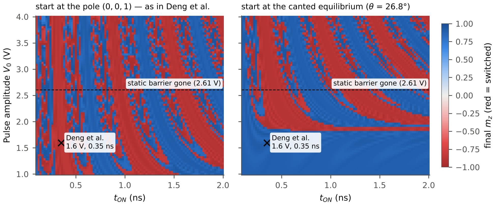
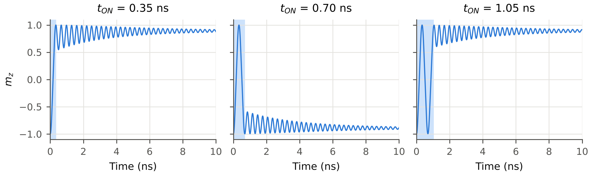
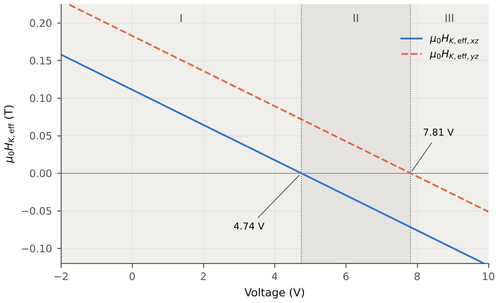
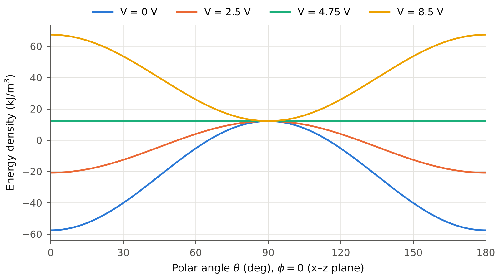
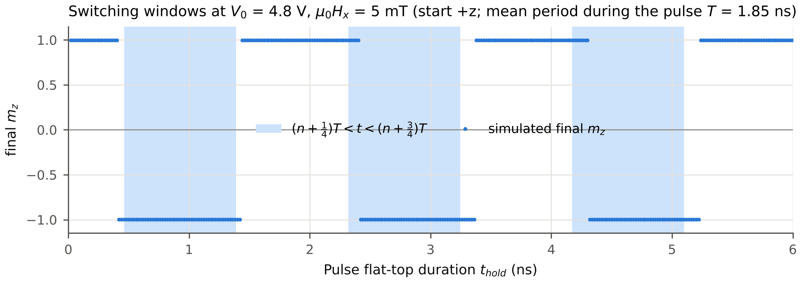
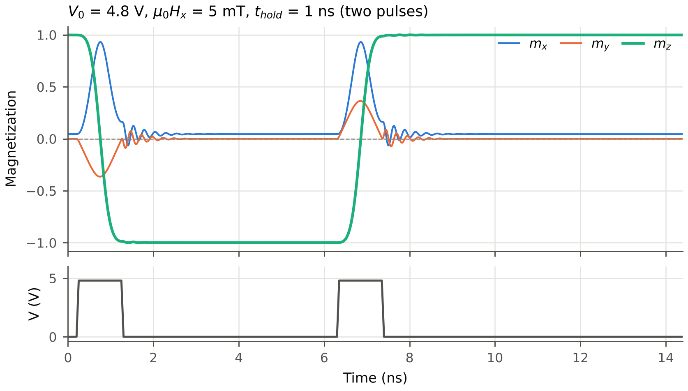
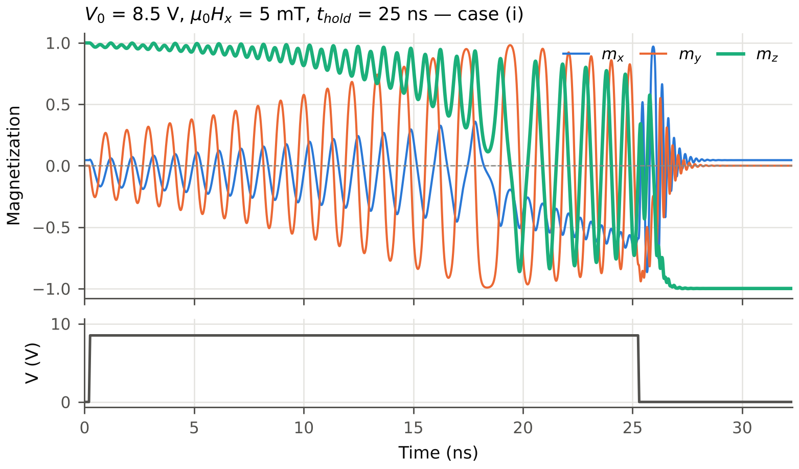
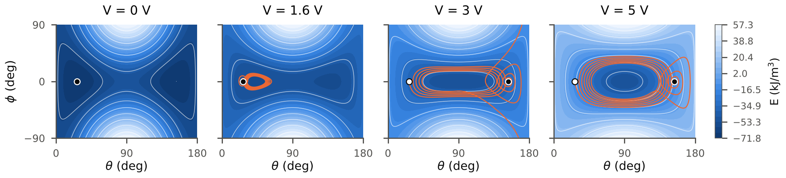
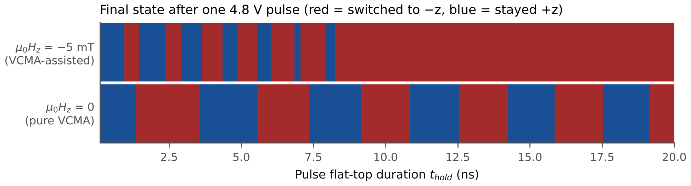

# VCMA switching of an elliptical perpendicular MTJ: macrospin LLG study


A self-contained, tested Python implementation of **voltage-controlled magnetic anisotropy (VCMA)** switching in the
150 × 50 × 1.7 nm³ elliptical CoFeB/MgO free layer of Deng, Liang & Gupta (*Sci. Rep.* **7**, 16562, 2017).
It reproduces the paper's precessional switching result, then maps how the free layer responds to pulse amplitude,
pulse width and bias field: near-critical precession, inverted-anisotropy dynamics, high-field operation, and
VCMA-assisted field-driven switching.

<p align="center">
  <br>
  <em>Final m<sub>z</sub> after a single VCMA pulse (50 mT in-plane bias) versus pulse amplitude and ON-time.
  Left: starting at the pole, as in the paper's figure. Right: starting at the true, bias-canted equilibrium.</em>
</p>

## Highlights

- **Exact shape anisotropy for a thin elliptic cylinder.** The free layer is not an ellipsoid, so the demagnetization
  tensor is computed from the Fourier-space expressions of Beleggia *et al.* (2005, 2006):
  **N<sub>x</sub> = 0.012241, N<sub>y</sub> = 0.057682, N<sub>z</sub> = 0.930077**.
- **Paper reproduced.** With a 1.6 V pulse and a 50 mT bias, ON-times of 0.35 and 1.05 ns (odd multiples of
  T/2 = 0.357 ns) switch the layer and 0.70 ns does not, matching Deng *et al.*, Fig. 2.
- **The initial condition matters.** The 50 mT bias cants the stable states 26.8° off the z-axis. Starting from that
  canted equilibrium instead of the idealised pole, the 1.6 V operating point **does not switch**. Switching then needs
  V<sub>0</sub> ≳ 1.84 V, still below the 2.61 V at which the field alone removes the static barrier (map above).
- **Critical voltages.** The x–z and y–z barriers vanish at **4.74 V** and **7.81 V**. The zero-voltage
  easy-axis switching field is **111 mT**.
- **Switching windows quantified.** At 4.8 V / 5 mT the layer switches for flat-top durations of 0.42–1.42, 2.42–3.36
  and 4.32–5.22 ns, i.e. the (n+¼)T–(n+¾)T rule with T ≈ 1.9 ns. Above V<sub>yz</sub> the windows shrink to
  0.1–0.5 ns, so timing control becomes impractical.
- **VCMA-assisted field switching is deterministic.** At 4.8 V the required easy-axis field drops from 111 mT to about
  zero. With −5 mT, every pulse longer than 8.3 ns ends in −z, while pure VCMA keeps alternating with pulse width.
- **Engineering.** Installable package, numba-compiled RK4 integrator (~20 ms per 10 ns trajectory), 11 unit tests
  (analytic limits, energy conservation, cross-check against an adaptive DOP853 solver), and one script that rebuilds
  every figure.

## Physical model

Macrospin free-energy density (Eq. 3 of the report), with K<sub>d</sub> = μ<sub>0</sub>M<sub>s</sub><sup>2</sup>/2:

$$\frac{E}{V} = -K_u(V)\,m_z^2 + K_d\left(N_x m_x^2 + N_y m_y^2 + N_z m_z^2\right) - M_s\,\mathbf{B}_{\mathrm{bias}}\cdot\mathbf{m},
\qquad K_u(V) = K_{U,\mathrm{bulk}} + \frac{K_{I0} - \xi V/t_{\mathrm{MgO}}}{t_{FL}}$$

Landau–Lifshitz–Gilbert dynamics (STT and thermal terms omitted, as in the paper's regime):

$$\frac{d\mathbf{m}}{dt} = -\frac{\gamma}{1+\alpha^2}\left[\mathbf{m}\times\mathbf{B}_{\mathrm{eff}} + \alpha\,\mathbf{m}\times(\mathbf{m}\times\mathbf{B}_{\mathrm{eff}})\right],
\qquad \mathbf{B}_{\mathrm{eff}} = -\frac{1}{M_s}\frac{\partial (E/V)}{\partial \mathbf{m}}$$

The barrier along the x–z (y–z) path vanishes when
$K_{\mathrm{eff},xz}(V) = K_u(V) - K_d(N_z - N_x) = 0$ (or with N<sub>y</sub> in place of N<sub>x</sub>). The trapezoidal pulse
has 50 ps rise and fall times. Integration uses fixed-step RK4 at 0.1 ps with |**m**| renormalised every step.

| Parameter | Value | Parameter | Value |
|---|---|---|---|
| M<sub>s</sub> | 1.257 × 10⁶ A/m | t<sub>FL</sub>, t<sub>MgO</sub> | 1.7 nm, 2.0 nm |
| K<sub>U,bulk</sub> | 2.245 × 10⁵ J/m³ | K<sub>I0</sub> | 1.286 mJ/m² |
| ξ (VCMA) | 50 fJ V⁻¹ m⁻¹ | α | 0.01 |
| γ | 1.7609 × 10¹¹ rad s⁻¹ T⁻¹ | footprint | 150 × 50 nm² ellipse |

## Results

### 1. Reproduction of Deng *et al.* (1.6 V, 50 mT)



The half precession period about the 50 mT bias, T/2 = π(1+α²)/(γμ<sub>0</sub>H<sub>x</sub>) = 0.357 ns, sets the
switching ON-times. Odd multiples switch the layer and even multiples return it to the start.

### 2. Anisotropy versus voltage

<p>


</p>

Regime I (V < 4.74 V): both out-of-plane barriers present. Regime II: the x–z barrier is inverted and an energy path
opens through ±x. Regime III (V > 7.81 V): ±z become energy maxima.

### 3. Switching regimes

| Regime | Conditions | Result |
|---|---|---|
| Near-critical, low field | 4.8 V, 5 mT | coherent precession, T ≈ 1.9 ns; switching for 0.42–1.42 ns, 2.42–3.36 ns, … |
| High voltage, low field | 8.5 V, 5 mT | m spirals out from +z; first switching window at 13.6 ns, then 0.1–0.5 ns-wide windows |
| High field | 50 mT, 0–5 V | barrier removed above 2.61 V; m orbits the x axis |
| VCMA-assisted field | 4.8 V, (0.5, 0, −5) mT | deterministic −z for every pulse ≥ 8.3 ns |

<p>

</p>
<p>


</p>



Every figure of the report is in [`figures/`](figures). The notebooks walk through each one.

## Repository layout

```
vcma-pmtj-switching/
├── src/vcma_mtj/            # installable package
│   ├── demag.py             #   Beleggia elliptic-cylinder demagnetization factors
│   ├── device.py            #   material parameters, anisotropies, critical voltages, periods
│   ├── energy.py            #   free energy, canted equilibria, barrier
│   ├── pulses.py            #   trapezoidal pulses and pulse trains
│   ├── llg.py               #   numba-compiled RK4 LLG integrator
│   ├── experiments.py       #   every scenario used in the report, in one place
│   └── plotting.py          #   consistent figure style
├── notebooks/
│   ├── 01_deng2017_reproduction.ipynb
│   └── 02_vcma_switching_regimes.ipynb
├── scripts/
│   ├── make_figures.py      # rebuilds figures/ and data/results.json
│   └── build_notebooks.py   # regenerates and executes the notebooks
├── figures/                 # PNG (300 dpi) + vector PDF
├── data/                    # cached parameter scans (.npz) and quoted numbers (results.json)
├── report/VCMA_switching_report.docx
└── tests/test_physics.py
```

## Quick start

```bash
git clone https://github.com/shakir1ahmed3/vcma-pmtj-switching.git
cd vcma-pmtj-switching
python -m pip install -e ".[fast,dev,notebooks]"   # numba is optional but ~100x faster

pytest                                   # 11 tests, ~5 s
python scripts/make_figures.py           # all figures; parameter scans load from data/ (~1 min)
python scripts/make_figures.py --recompute   # also re-run the scans (~6 min with numba)
jupyter lab notebooks/
```

Minimal use:

```python
import vcma_mtj as vm

dev = vm.deng2017()                                   # 150 x 50 x 1.7 nm^3 ellipse
print(dev.Nx, dev.Ny, dev.Nz, dev.V_xz, dev.V_yz)     # ≈ 0.01224 0.05768 0.93008 4.744 7.812

pulse = vm.PulseTrain(vm.Pulse.from_t_on(1.6, 0.35e-9))
res = vm.simulate(dev, pulse, m0=[0, 0, -1], t_end=10e-9, bias=(50e-3, 0, 0))
print(res.switched, res.final.round(2))               # True [ 0.48 -0.03  0.88]
```

## Validation

`tests/test_physics.py` checks:

- the demagnetization factors against the reference values, the thin-film limit (N<sub>z</sub> → 1) and the circular
  limit (N<sub>x</sub> = N<sub>y</sub>);
- the critical voltages, the 111 mT switching field and the 0.357 ns half period;
- the canted equilibrium against the analytic m<sub>x</sub> = B<sub>x</sub>/μ<sub>0</sub>H<sub>K,eff,xz</sub>;
- |**m**| = 1 and energy conservation when α = 0;
- the RK4 trajectory against SciPy's adaptive DOP853 solver (agreement to 10⁻⁶);
- the paper's switch / no-switch pattern and the near-critical switching windows.

## Limitations and outlook

- **Macrospin, T = 0.** No thermal field and no spin-transfer torque. Adding a stochastic field would turn the
  deterministic maps above into switching-probability maps, and adding STT would allow VCMA-assisted STT writing.
- **Voltages.** 2 V across 2 nm of MgO is already about 1 V/nm, near typical breakdown. The 4.8 V and 8.5 V cases
  map the macrospin regimes and are not proposed operating points. Realistic operation needs a larger ξ or a thinner
  free layer, both of which the package supports through `Device(...)`.
- **Post-pulse damping.** In the regime studies α is raised from 0.01 to 0.1 starting 0.1 ns after each pulse, to
  shorten the ring-down. This changes only how fast the layer settles, not which state it settles in. The Deng
  reproduction and the phase diagram use α = 0.01 throughout.
- The reference-layer stray field is not modelled.

## Report

[`report/VCMA_switching_report.docx`](report/VCMA_switching_report.docx) is the full write-up (EEE 6411, BUET): theory,
device setup, and discussion of every figure.

## Citation

If this code is useful, please cite it via [`CITATION.cff`](CITATION.cff), together with the original work:

- J. Deng, G. Liang, G. Gupta, "Ultrafast and low-energy switching in voltage-controlled elliptical pMTJ,"
  *Sci. Rep.* **7**, 16562 (2017).
- M. Beleggia, M. De Graef, Y. T. Millev, D. A. Goode, G. Rowlands, "Demagnetization factors for elliptic cylinders,"
  *J. Phys. D* **38**, 3333 (2005); M. Beleggia, M. De Graef, Y. T. Millev, *J. Phys. D* **39**, 891 (2006).
- Y. Shiota *et al.*, *Nat. Mater.* **11**, 39 (2012); S. Kanai *et al.*, *Appl. Phys. Lett.* **101**, 122403 (2012);
  R.-A. One *et al.*, *Sci. Rep.* **11**, 8801 (2021); J. Song *et al.*, *IEEE JXCDC* **4**, 76 (2018).

## License

MIT © 2026 Shakir Ahmed. See [LICENSE](LICENSE).
